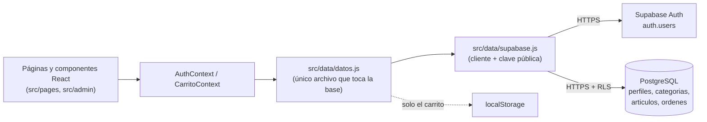
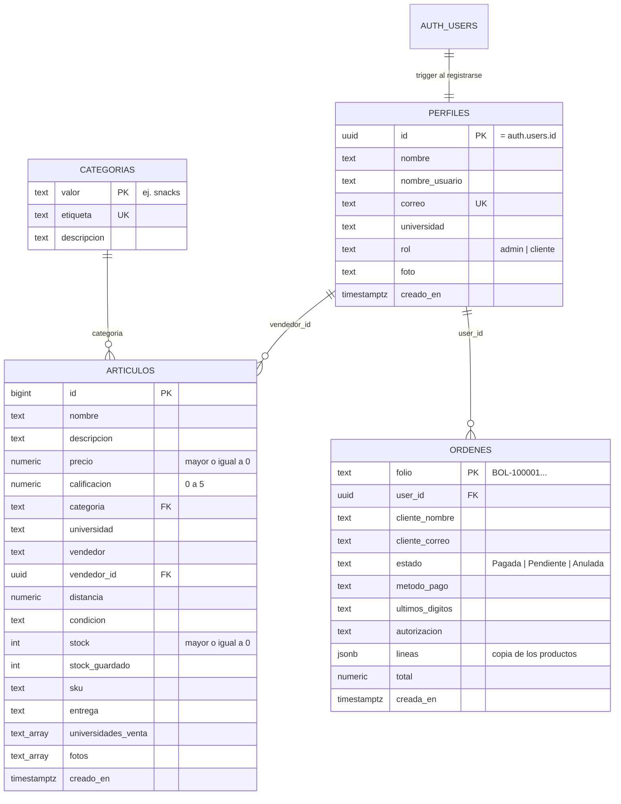
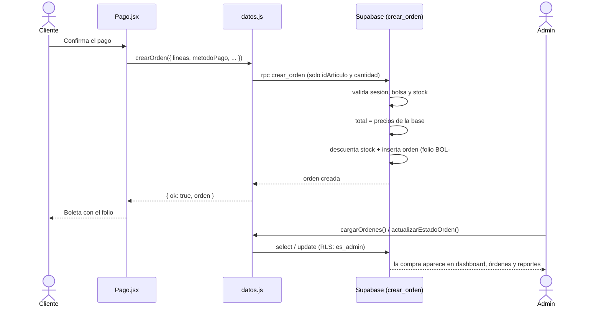

# UniMarket (React)

Marketplace estudiantil migrado de HTML + JS puro a **React + Vite + React Router + Tailwind**.
Los datos (usuarios, artículos, categorías y órdenes) viven en **Supabase** (PostgreSQL + Auth). Solo el carrito queda en el `localStorage` de cada dispositivo.

## Cómo ejecutarlo

1. Crea un proyecto en [supabase.com](https://supabase.com). En **SQL Editor -> New query** pega todo `supabase/esquema.sql` y pulsa **Run** (se puede repetir sin duplicar datos).
2. En **Authentication -> Providers -> Email** puedes desactivar "Confirm email" para probar sin confirmar correos.
3. En **Project Settings -> API** copia la **Project URL** y la clave **publishable**. Copia `.env.example` a `.env` y pega los valores (nunca uses la clave `service_role` ni subas `.env` a GitHub).
4. Instala y arranca:

```bash
npm install
npm run dev      # servidor de desarrollo (http://localhost:5173)
npm run build    # build de producción en /dist
```

Sin el archivo `.env` la app muestra "Falta configurar Supabase". No hay cuentas de prueba
precargadas: regístrate en `/registro` y, para el primer administrador, ejecuta en el SQL Editor:

```sql
update public.perfiles set rol = 'admin' where correo = 'tu-correo@ejemplo.cl';
```

Cierra sesión y vuelve a entrar: te lleva a `/admin`.

## Base de datos (Supabase)

Todo el acceso a Supabase pasa por un solo archivo, `src/data/datos.js`. Las páginas nunca llaman a la
base directamente: usan sus funciones, que devuelven `{ ok, mensaje, ... }`. El script
`supabase/esquema.sql` crea todo lo descrito aquí y se puede ejecutar más de una vez.

### Flujo general



La app usa la clave **publishable** (pública por diseño). Lo que cada persona puede leer o escribir
lo decide la base con políticas RLS, no el código de React.

### Modelo de tablas



### Esquema detallado

**`perfiles`**: una fila por cuenta (la crea el trigger al registrarse).

| Columna | Tipo | Restricciones | Descripción |
|---|---|---|---|
| `id` | `uuid` | PK, FK -> `auth.users(id)` `on delete cascade` | Mismo id que la cuenta de Auth |
| `nombre` | `text` | not null, default `''` | Nombre completo |
| `nombre_usuario` | `text` | not null, default `''` | Usuario visible |
| `correo` | `text` | not null, **unique** | Siempre en minúsculas; no se puede cambiar desde la tabla |
| `universidad` | `text` | not null, default `''` | Sede elegida |
| `rol` | `text` | not null, default `'cliente'`, check `admin` o `cliente` | Define el acceso al panel |
| `foto` | `text` | nullable | Foto de perfil (data URL comprimida) |
| `creado_en` | `timestamptz` | not null, default `now()` | Fecha de registro |

**`categorias`**: alimentan el catálogo, el formulario de publicar y el panel admin.

| Columna | Tipo | Restricciones | Descripción |
|---|---|---|---|
| `valor` | `text` | PK | Identificador estable (ej. `snacks`) |
| `etiqueta` | `text` | not null, **unique** | Nombre visible |
| `descripcion` | `text` | not null, default `''` | Texto de apoyo |

**`articulos`**: productos publicados.

| Columna | Tipo | Restricciones | Descripción |
|---|---|---|---|
| `id` | `bigint` | PK, `generated always as identity` | Identificador |
| `nombre` | `text` | not null | Título del producto |
| `descripcion` | `text` | not null, default `''` | Detalle |
| `precio` | `numeric(12,2)` | not null, check `>= 0` | Precio unitario |
| `calificacion` | `numeric(2,1)` | not null, default `0`, check entre 0 y 5 | Estrellas |
| `categoria` | `text` | not null, FK -> `categorias(valor)` `on update cascade on delete restrict` | No se borra una categoría con artículos |
| `universidad` | `text` | not null, default `''` | Sede del vendedor |
| `vendedor` | `text` | not null, default `'UniMarket'` | Nombre visible del vendedor |
| `vendedor_id` | `uuid` | FK -> `perfiles(id)` `on delete set null` | Dueño de la publicación |
| `distancia` | `numeric(6,2)` | not null, default `0` | Distancia en km |
| `condicion` | `text` | not null, default `'Nuevo (Sellado)'` | Estado del producto |
| `stock` | `integer` | not null, default `0`, check `>= 0` | Unidades disponibles |
| `stock_guardado` | `integer` | nullable | Stock previo a marcarlo "Agotado" |
| `sku` | `text` | not null, default `''` | Código interno |
| `entrega` | `text` | not null, default `'A convenir'` | Punto de entrega |
| `universidades_venta` | `text[]` | not null, default `{}` | Sedes que pueden comprarlo (vacío = todas) |
| `fotos` | `text[]` | not null, default `{}` | Fotos (data URLs) |
| `creado_en` | `timestamptz` | not null, default `now()` | Fecha de publicación |

Índices: `articulos_categoria_idx (categoria)` y `articulos_vendedor_idx (vendedor_id)`.

**`ordenes`**: compras realizadas (solo se crean con `crear_orden`).

| Columna | Tipo | Restricciones | Descripción |
|---|---|---|---|
| `folio` | `text` | PK, default `'BOL-' \|\| nextval('folio_seq')` | Número de boleta: `BOL-100001`, `BOL-100002`... |
| `user_id` | `uuid` | FK -> `perfiles(id)` `on delete set null` | Cliente (queda vacío si se borra la cuenta) |
| `cliente_nombre` | `text` | not null, default `''` | Copia del nombre al comprar |
| `cliente_correo` | `text` | not null | Copia del correo al comprar |
| `estado` | `text` | not null, default `'Pagada'`, check `Pagada`, `Pendiente` o `Anulada` | Lo cambia el admin |
| `metodo_pago` | `text` | not null, default `''` | Tarjeta de crédito, débito, etc. |
| `ultimos_digitos` | `text` | not null, default `''` | Últimos 4 dígitos de la tarjeta |
| `autorizacion` | `text` | not null, default `''` | Código de autorización simulado |
| `lineas` | `jsonb` | not null, default `[]` | Productos comprados (ver abajo) |
| `total` | `numeric(12,2)` | not null, default `0` | Calculado en el servidor |
| `creada_en` | `timestamptz` | not null, default `now()` | Fecha de compra |

Índice: `ordenes_correo_idx (lower(cliente_correo))` para el historial por correo. Secuencia: `folio_seq` (inicia en 100001).

Cada elemento de `lineas` guarda una copia de lo comprado, así la boleta no cambia si luego se edita el producto:

```json
{ "idArticulo": 3, "nombre": "Brownies", "categoria": "snacks", "vendedor": "Juan", "precio": 2.5, "cantidad": 2 }
```

### Reglas que impone la base

| Regla | Dónde |
|---|---|
| El correo es único | `perfiles.correo`, `categorias.etiqueta` |
| Precio y stock nunca negativos | check en `articulos` |
| No se borra una categoría con artículos | FK `restrict` |
| Borrar un usuario no borra sus artículos ni sus órdenes | FK `set null` |
| Borrar la cuenta de Auth borra el perfil | FK `cascade` |
| Siempre queda al menos un administrador | trigger `proteger_perfiles` |
| Solo un admin cambia roles | trigger `proteger_perfiles` |

### Funciones y triggers

| Elemento | Qué hace |
|---|---|
| `al_registrarse` (trigger en `auth.users`) | Crea la fila de `perfiles` con los datos del registro. **Siempre** con rol `cliente`. |
| `proteger_perfiles_trg` (trigger en `perfiles`) | Solo un admin puede cambiar roles; el correo no se puede modificar desde `perfiles`; no deja quitar ni borrar al único administrador. |
| `es_admin()` | Devuelve `true` si quien consulta tiene `rol = 'admin'`. La usan las políticas. |
| `crear_orden(lineas, metodo, digitos, autorizacion)` | La única vía de compra. Valida sesión, bolsa y stock; calcula el total con los precios de la base; descuenta el stock y genera el folio, todo en una sola transacción. |
| `eliminar_usuario(id)` | Solo admin. Borra la cuenta de Auth y el perfil cae en cascada. |

### Quién puede hacer qué (RLS)

| Tabla | Sin sesión | Cliente | Admin |
|---|---|---|---|
| `perfiles` | nada | ver y editar solo el suyo (sin cambiar rol) | ver, editar y eliminar todos |
| `categorias` | leer | leer | leer, crear, editar y borrar |
| `articulos` | leer | leer; crear, editar y borrar los suyos | todo |
| `ordenes` | nada | ver las suyas; comprar con `crear_orden` | ver todas y cambiar el estado |

Los clientes no pueden insertar en `ordenes` directamente: la política de inserción solo admite al admin,
y la compra entra por `crear_orden`, así nadie puede falsear precios, totales ni stock.

### Flujo de una compra



Si falta stock, la función lanza un error (`Stock insuficiente de "..."`), nada se descuenta y la app vuelve
al paso de pago sin vaciar la bolsa.

### Flujo de registro y rol

1. `/registro` llama a `supabase.auth.signUp` con nombre, usuario y universidad.
2. El trigger `al_registrarse` crea el perfil con rol `cliente`.
3. Para volver administrador a alguien, otro admin cambia su rol en `/admin/usuarios`; el primer admin se crea con un `update` en el SQL Editor (ver "Cómo ejecutarlo").
4. Al iniciar sesión, `AuthContext` lee el perfil: si `rol = 'admin'` entra a `/admin`, si no, a la tienda.

### Datos de ejemplo y verificación

`esquema.sql` carga 5 categorías, 4 artículos y 6 órdenes de ejemplo. El comportamiento (CRUD de admin, flujo
cliente -> admin, stock y rechazo por falta de stock) está cubierto por las pruebas de `src/pruebas-extra`,
que usan una base en memoria (`src/tests/supabaseFalso.js`) con la misma lógica de `crear_orden`.

## Equivalencias HTML -> React

| Antes | Ahora (ruta) | Archivo |
|---|---|---|
| `index.html` | `/` | `src/pages/Catalogo.jsx` |
| (nueva) | `/` sin sesión y `/quienes-somos` | `src/pages/QuienesSomos.jsx` (portada pública; con sesión, `/` muestra el catálogo) |
| `login.html` | `/login` | `src/pages/Login.jsx` |
| `registro.html` | `/registro` | `src/pages/Registro.jsx` |
| `publicar.html` | `/publicar` | `src/pages/Publicar.jsx` |
| `panel-vendedor.html` | `/panel-vendedor` | `src/pages/PanelVendedor.jsx` |
| `bolsa.html` | `/bolsa` | `src/pages/Bolsa.jsx` |
| `pago.html` | `/pago` | `src/pages/Pago.jsx` |
| `pedidos.html` | `/pedidos` | `src/pages/Pedidos.jsx` |
| `perfil.html` | `/perfil` | `src/pages/Perfil.jsx` |

| Antes | Ahora |
|---|---|
| `js/datos.js` (funciones en `window`) | `src/data/datos.js` (módulo ES, se importa) |
| `js/interfaz.js` (clase `MenuPerfil`) | `src/components/MenuPerfil.jsx` |
| `js/publicar.js` (`SelectorModal`, `CargadorFotos`, `FormularioPublicacion`) | `SelectorModal.jsx` + estado dentro de `Publicar.jsx` |
| `js/catalogo.js` | estado + `useMemo` dentro de `Catalogo.jsx` |
| funciones repetidas en cada `<script>` (`escaparHtml`, `obtenerColorImagen`, `obtenerLineasDeBolsa`...) | `src/utils/utilidades.js` (una sola vez) |
| `haySesionActiva()` + redirección manual en cada página | `AuthContext` + `components/Rutas.jsx` |
| carrito leído/escrito en cada página | `CarritoContext` (el contador del header se actualiza solo) |
| header copiado en 3 páginas | `src/components/Header.jsx` |
| `css/*.css` | `src/styles/*.css` (sin cambios, salvo 2 clases renombradas) |

## Cambios a tener en cuenta

- **Tailwind** ya no va por CDN: se instala con npm (`tailwind.config.js` conserva los colores `primary`, `accent`, `surface`).
- **Font Awesome** sigue cargándose por CDN desde `index.html`.
- Como ahora todo el CSS convive en una sola app, se renombraron 2 clases que chocaban:
  `.form-hint` -> `.auth-hint` (solo login) y `.card` -> `.perfil-card` (solo perfil).
- Cada página agrega su clase al `<body>` (`auth-body`, `perfil-body`...) con el hook `useBodyClass`.
- `escaparHtml()` desapareció: React escapa el texto automáticamente.
- `USUARIO_ACTUAL` (usuario de ejemplo de respaldo) se eliminó: las rutas protegidas ya garantizan que hay sesión.
- Al guardar el perfil ya no se recarga la página: la sesión se actualiza y toda la app se refresca sola.
- Las contraseñas las maneja Supabase Auth (cifradas); la app nunca las guarda.

## Componentes (`src/components/`): 10

| # | Componente | Qué hace | Dónde se usa |
|---|---|---|---|
| 1 | `Header` | Barra superior: logo, buscador, perfil y carrito | Catálogo, Publicar, Panel vendedor |
| 2 | `Footer` | Pie de página con beneficios, filtros rápidos y copyright | Catálogo |
| 3 | `Logo` | Logo que lleva al inicio | Header, Footer, Login, Registro, Perfil, Pedidos, Bolsa, Pago |
| 4 | `MenuPerfil` | Botón de perfil con menú desplegable | Header |
| 5 | `SelectorModal` | Selector de una opción dentro de un modal | Publicar |
| 6 | `GuardiaRuta` | Controla quién puede entrar a cada página | App |
| 7 | `TarjetaArticulo` | Tarjeta de un producto en la grilla | Catálogo |
| 8 | `ModalProducto` | Detalle del producto y botón "Agregar a la bolsa" | Catálogo |
| 9 | `BannerPagina` | Banner azul con título y botón de volver | Bolsa, Pedidos |
| 10 | `EstadoVacio` | Mensaje "no hay nada" con botón de acción | Bolsa, Pedidos |

Las páginas (`src/pages/`) arman estos componentes y manejan el estado de cada pantalla.

## Panel de administración

El administrador es una cuenta con `rol = 'admin'` en la tabla `perfiles`.
Al iniciar sesión entra directo a `/admin`; el menú de perfil muestra "Administración" solo si el rol es admin.
La seguridad real está en las políticas RLS de la base (un cliente no puede leer órdenes ajenas ni cambiar roles).

| Ruta | Vista |
|---|---|
| `/admin` | Dashboard (métricas, módulos, últimas órdenes) |
| `/admin/ordenes`, `/admin/ordenes/:folio` | Órdenes y boleta (cambio de estado, imprimir) |
| `/admin/productos`, `/nuevo`, `/:id`, `/:id/editar`, `/criticos` | CRUD de productos y stock crítico |
| `/admin/categorias`, `/nueva`, `/:valor/editar` | CRUD de categorías (alimentan catálogo y publicar) |
| `/admin/usuarios`, `/nuevo`, `/:correo`, `/:correo/editar`, `/:correo/historial` | CRUD de usuarios e historial de compras |
| `/admin/reportes` | Ventas por categoría y mes, más vendidos, stock crítico, CSV |
| `/admin/perfil` | Perfil del administrador |

Usa Bootstrap 5 solo dentro de `/admin` (se carga y se quita al entrar/salir)
para no chocar con Tailwind de la tienda. Los datos viven en `src/data/datos.js`.

## Pruebas

```bash
npm run test            # Vitest: las 10 pruebas de componentes React (src/tests)
npm run test:coverage   # Vitest + cobertura
npm run test:karma      # Jasmine + Karma: las mismas 10 pruebas, en Chrome real
npm run test:extra      # Vitest: pruebas adicionales de la capa de datos (src/pruebas-extra, 87)
npm run test:todo       # Vitest: las 97 pruebas juntas
npm run test:karma:todo # Jasmine + Karma: las 97 pruebas juntas
```

